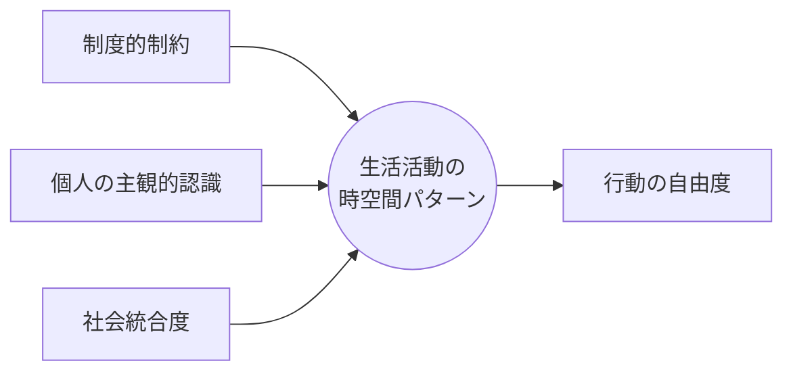
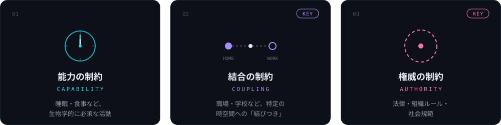

<div align="center">



<br>

[](https://nakaya-geolab.com/)
[](https://sites.google.com/view/humangeo)
[](https://sites.google.com/view/srrs-rg)
[](https://www.google.com/maps/place/Sendai)

<br>

<a href="#about"><code>about</code></a> ·
<a href="#research"><code>research</code></a> ·
<a href="#publications"><code>publications</code></a> ·
<a href="#education"><code>education</code></a> ·
<a href="#awards"><code>awards</code></a> ·
<a href="#talks"><code>talks</code></a> ·
<a href="#teaching"><code>teaching</code></a> ·
<a href="#contributions"><code>contributions</code></a> ·
<a href="#credentials"><code>credentials</code></a> ·
<a href="#stack"><code>stack</code></a>

</div>

<br>


<a id="about"></a>

## `01` / About

<div align="center">


</div>

<br>

<table>
<tr>
<td width="72%" valign="top">

時間地理学的アプローチを用いて、**生活活動の時空間パターンと行動の自由度**に焦点をあてながら、制度的制約・個人の主観的認識・社会統合度という3つの視点から、技能実習生が置かれた状況の多面的な解明に関する研究に取り組んでいます。

|  | **detail** |
|:---:|---|
| `AFFIL` | [東北大学大学院環境科学研究科](https://www.kankyo.tohoku.ac.jp/) 先端環境創成学専攻 博士前期課程 |
| `LAB` | [中谷友樹研究室](https://nakaya-geolab.com/)（環境地理学分野） |
| `THESIS` | **修士論文テーマ**：東日本大震災被災地における外国人技能実習生の生活活動分析 |
| `GROUP` | [東北大学人文地理学グループ](https://sites.google.com/view/humangeo) |
| `GROUP` | [社会調査・地域統計研究グループ](https://sites.google.com/view/srrs-rg)（日本地理学会） |

</td>
<td width="28%" align="center" valign="top">


</td>
</tr>
</table>



<br>


<a id="research"></a>

## `02` / Research

`地理情報科学` `行動地理学` `社会地理学` `時間地理学` `移民地理` `災害地理学`

### 研究の背景と問題意識

日本の技能実習制度は、アジア諸国からの実習生受け入れの中核を担っています。しかし近年、以下のような現象が顕著化しています：

<table>
<tr>
<td width="33%" valign="top">

<h2 align="center">9,753</h2>

**失踪・流出の増加**<br>
実習中の失踪件数9,753人（2023年）、特に地方圏から大都市への流出が加速

</td>
<td width="33%" valign="top">

<h2 align="center">GAP</h2>

**制度目的と実態の乖離**<br>
国際技能移転を掲げながら、実際には低賃金労働の補填に利用される現実

</td>
<td width="33%" valign="top">

<h2 align="center">INVISIBLE</h2>

**「顔の見えない定住化」**<br>
職住一体の管理体制により、受け入れ社会とは社会的に「見えない存在」となる可能性が高い（梶田ほか 2005）

</td>
</tr>
</table>

### 既往研究における課題

既存研究の多くは、制度批判や労働権侵害といった**マクロなレベルでの問題指摘**に重点を置いてきました。一方で、**実習生が日常的にどのような生活世界を営んでいるのか**、そして**地域社会との関係の中でいかなる空間的・社会的制約に直面しているのか**といった、ミクロで生活実態に即した地理学的研究は、相対的に停滞してきました（馮 2012；宋 2017；Okumura 2021）。

> [!IMPORTANT]
> 技能実習生が日常的に **いつ、どこで、誰と、何をしているのか**
> この問いに答えることで初めて、制度的制約と個人の選択肢、そして受け入れ地域との関係が、
> 実際の生活にいかに影響するのかが見えてくると考えています。

### 理論的フレームワーク：時間地理学的アプローチ

研究のアプローチとして、**時間地理学（Time Geography）** の視点を採用しています。Hägerstrand (1970) が提唱したこのアプローチは、個人の日常生活を**時間軸と空間軸の交差**の中で捉え、その制約要因を明らかにしようとするものです。

個人が時空間の中で営む行動は、以下の3つの層の制約によって規定されます：

<div align="center">



</div>

<br>

技能実習生の場合、特に**結合の制約**（職場と宿舎の往復）と**権威の制約**（外出規制、門限、企業による生活指導）が強く作用していることが考えられます。この「構造的に限定された時空間」の中で、いかなる生活や社会関係の姿が存在しているのかを問うことが、本研究の中核です。

### 目指す研究成果と社会的意義

本研究は、以下の観点から、日本の外国人受け入れ政策とその地域的実践に対して、実証的な知見を提供することを目指します：

<table>
<tr>
<td width="50%" valign="top">

**学術的貢献**
```
→ ミクロな生活実態からみた技能実習生の行動制約構造の解明
→ 「見えない存在化」のメカニズムに対する地理学的理解の深化
```

</td>
<td width="50%" valign="top">

**社会的含意**
```
→ 技能実習生の「生活者」としての現実の可視化
→ 制度設計と地域実践の改善に向けた実証的課題の提示
→ 包摂的な外国人受け入れのあり方に関する基礎的知見の提供
```

</td>
</tr>
</table>

<br>


<a id="publications"></a>

## `03` / Publications

### 学位論文

**2024年度 駒澤大学 卒業論文**
*岩手県大槌町における災害弱者の行動分析 — 東南アジア系外国人労働者を事例に —*

📄 [要旨を見る](./docs/graduation_thesis_abstract.md)

### 共著論文

> 小坪将輝・関根良平・磯田　弦・井上大輝・児玉尚汰・菅井　翔・田中文理・中尾太一・中谷友樹 (2026). 仙台市中心部における放置自転車の空間的分布, *季刊地理学*, 78(2), 89–98.

📄 [論文を見る](https://www.jstage.jst.go.jp/article/tga/78/2/78_89/_article/-char/ja) ・ 📄 [要旨を見る](https://doi.org/10.14866/ajg.2025a.0_22)

<br>


<a id="education"></a>

## `04` / Education

| 期間 | 所属 |
|:---:|---|
| **2025.04 –** | [東北大学大学院環境科学研究科](https://www.kankyo.tohoku.ac.jp/) 先端環境創成学専攻 **博士前期課程**<br>環境地理学分野（中谷友樹研究室） |
| **2025.03** | [駒澤大学文学部地理学科](https://www.komazawa-u.ac.jp/gakubu/bun/geography/) **地域文化研究専攻 卒業** |
| **2021.03** | [岩手県立釜石高等学校](https://www2.iwate-ed.jp/kas-h/) **卒業** |

<br>


<a id="awards"></a>

## `05` / Awards

<details open>
<summary><code>2021</code> · <b>学部1年</b> — Yahoo賞（Civictech Challenge Cup U-22）</summary>
<br>

**Yahoo賞 — Civictech Challenge Cup U-22**

津波避難支援アプリ「なみ逃げ」を開発。

- 📰 [駒澤大学広報紹介ページ](https://www.komazawa-u.ac.jp/news/extracurricular/2021/1215-10942.html)
- 📋 [プロダクト概要](https://hackmd.io/@goEztN4ITr6_QPGyhqP-9g/rkaz2W3f9?fbclid=PAZXh0bgNhZW0CMTEAAabmKU7M4kgvWlF1fUVnETmeep4m7NJlPleZdQnLR7fv-m5IUxhIce2lbgQ_aem_8Z62qI2RRWkHwRc0imO89A)
- 🎥 [最終審査会アーカイブ](https://www.youtube.com/watch?v=PB4Wg-y1JrI)
- 🌐 [公式ホームページ](https://ccc2021.code4japan.org/)
- 📰 [PRタイムズプレスリリース（2021年10月18日）](https://prtimes.jp/main/html/rd/p/000000039.000039198.html)

</details>

<details>
<summary><code>2022</code> · <b>学部2年</b> — 学長奨励賞 / 学長学業奨励賞</summary>
<br>

**学長奨励賞**
[授与式ページ](https://www.komazawa-u.ac.jp/news/event/2022/0320-14040.html) · [大学広報（2022年3月23日発行）](https://www.komazawa-u.ac.jp/about/public-relations/news/2022/0330-11791.html)

**令和4年度学長学業奨励賞**
[授与式ページ](https://www.komazawa-u.ac.jp/news/event/2022/0623-12238.html)

</details>

<details>
<summary><code>2023</code> · <b>学部3年</b> — 学長学業奨励賞</summary>
<br>

**令和5年度学長学業奨励賞**

- 🎓 [授与式ページ](https://www.komazawa-u.ac.jp/news/event/2023/0512-14306.html)
- 🏅 [OpenBadge](https://www.openbadge-global.com/api/v1.0/openBadge/v2/Wallet/Public/GetAssertionShare/Z0ZhSDZNVVVQWWpORk9vVTgwYm9OUT09)

</details>

<details>
<summary><code>2024</code> · <b>学部4年</b> — 学長賞 / 学科特別賞 / 若手地理学研究者育成制度 ほか</summary>
<br>

**学業成績優秀者奨学金奨学生**
[詳細ページ](https://www.komazawa-u.ac.jp/news/event/2024/0520-15747.html)

**令和6年度学長学業奨励賞**
[授与式ページ](https://www.komazawa-u.ac.jp/news/event/2024/0704-15935.html) · [OpenBadge](https://www.openbadge-global.com/api/v1.0/openBadge/v2/Wallet/Public/GetAssertionShare/Z2gzMXR4ajFuZkZYSDFXTmZZQXhiQT09)

**令和6年度学長賞**
[OpenBadge](https://www.openbadge-global.com/api/v1.0/openBadge/v2/Wallet/Public/GetAssertionShare/R0I1Y1Rpc1c3WEQ1NFRkMDJIVGxkUT09)

**令和6年度地理学科特別賞**

**令和6年度地理学科奨励賞**

**駒澤大学応用地理研究所 · 若手地理学研究者育成制度**
2025年日本地理学会春季学術大会での研究発表に際して受賞

</details>

<br>


<a id="talks"></a>

## `06` / Talks

<details open>
<summary><code>2025.02.15</code> · 令和6年度釜石高等学校SSH課題研究発表会</summary>
<br>

**招待講演・助言者として登壇**

講演テーマ： *「SSH探究活動と発展的研究」*

- 📖 [発表の様子（詳細）](./docs/SSH_seminar.md)
- 📋 [実施要項](https://www2.iwate-ed.jp/kas-h/contents/R6/full/SSH_presentation.pdf)

</details>

<details>
<summary><code>2025.03.16</code> · 日本地理教育学会 全国地理学専攻学生卒業論文発表大会</summary>
<br>

- 📋 [大会案内](https://www.geoedu.jp/sotsuron.html)
- 📋 [大会プログラム](https://www.geoedu.jp/sotupro2024.pdf)

要旨・発表内容については、日本地理教育学会HP掲載後に共有予定。

</details>

<details>
<summary><code>2025.03.19–21</code> · 2025年日本地理学会春季学術大会</summary>
<br>

- 📋 [大会プログラム](https://www.ajg.or.jp/wp-content/uploads/2025/03/s2025_program.pdf)
- 📄 [発表要旨](https://www.jstage.jst.go.jp/article/ajg/2025s/0/2025s_162/_pdf/-char/ja)

**本発表は、駒澤大学応用地理研究所「若手地理学研究者育成制度」による助成を受けました。**

</details>

<details>
<summary><code>2025.09.20–22</code> · 2025年日本地理学会秋季学術大会</summary>
<br>

**演題：** *仙台市中心部における放置自転車の空間的分布*

**著者：** 小坪将輝・関根良平・磯田弦・井上大輝・**児玉尚汰**・菅井翔・田中文理・中尾太一・中谷友樹（東北大学）

- 📋 [大会プログラム](https://www.ajg.or.jp/wp-content/uploads/2025/08/a2025_program.pdf)
- 📄 [発表要旨](https://www.jstage.jst.go.jp/article/ajg/2025a/0/2025a_22/_pdf/-char/ja)

</details>

<details>
<summary><code>2026.02</code> · 令和7年度釜石高等学校SSH課題研究発表会</summary>
<br>

**招待講演**

講演演題： *「地図を武器に社会の課題へ挑む『地理情報科学』の世界」*

講演者： 児玉尚汰（東北大学大学院）

</details>

<br>


<a id="teaching"></a>

## `07` / Teaching

| 期間 | 科目名 | 大学 | 役割 |
|:---:|---|:---:|:---:|
| `2024.04 – 2025.01` | 地域文化演習D（演習） | 駒澤大学 | **SA** (Student Assistant) |
| `2025.10 – 2026.01` | 地理学（講義） | 東北大学 | **TA** (Teaching Assistant) |

<div align="center">

</div>

<br>


<a id="contributions"></a>

## `08` / Contributions

| 役割 | 業績・活動 | リンク |
|:---|:---|:---:|
| `分析データの整理` | **瀬戸寿一 (2024)**「データ品質検証ツールを用いたOpenStreetMapにおける編集傾向と特徴」*地理情報システム学会講演論文集*, 33, 1–4. | [researchmap](https://researchmap.jp/tosseto/published_papers/48310292) |
| `評者の討論に参加` | **瀬戸寿一 (2025)**「書評 ロブ・キチン, トレーシー・P・ローリオ, マシュー・W・ウィルソン編『空間メディアを理解すること』」*駒澤地理*, 61, 43–47. | [DOI](https://komazawa-u.repo.nii.ac.jp/records/2033845) |
| `データの収集作業に協力` | **瀬戸寿一 (2025)**「『地理情報科学と技術の知識体系』改訂版の内容分析から探る現代の地図・GIS教育ニーズ」*地図*, 63(2), 53–64. | [researchmap](https://researchmap.jp/tosseto/published_papers/50726110) |
| `調査協力` | **地域文化演習C（3年次瀬戸ゼミ）(2025)**「復興まちづくりの現在と情報化」 | [tosseto-lab](https://tossetolab.github.io/fieldstudies.html) |

<br>


<a id="credentials"></a>

## `09` / Credentials

### 所属学会

`日本地理学会` 2025年～ · `人文地理学会` 2026年～ · `地理情報システム学会` 2026年～

### 資格

| | |
|:---:|:---|
| `GIS` | **GIS学術士** |
| `SURVEY` | **地域調査士** |
| `LAND` | **測量士補** |
| `EDU` | **教員免許**（中学1種・社会 / 高校1種・地歴・地理歴史 / 高校1種・公民） |

<br>


<a id="stack"></a>

## `10` / Stack

<div align="center">

[](https://skillicons.dev)

<br><br>


<br><br>

<picture>
  <source media="(prefers-color-scheme: dark)" srcset="https://raw.githubusercontent.com/geoshota/geoshota/output/github-snake-dark.svg"/>
  
</picture>

<br>


</div>

<br>

